# HTTP Lab 1: Virtual Hosts

**Author:** Bea García Cogolludo
**Course:** 2nd year ASIR — IES Zaidín Vergeles

In this lab I set up several name-based virtual hosts on the same Apache web server. There are two websites, `apolo.olimpo.test` and `atenea.olimpo.test`, and both run on the same machine, `mercurio.olimpo.test`. Apache decides which site to show depending on the name you type in the browser.

Everything runs with Vagrant and VirtualBox.

---

## 1. Initial setup

### 1.1. Network

| Machine | Name | IP | Role |
|---|---|---|---|
| `dns` | `ns1.olimpo.test` | 192.168.57.10 | DNS server (BIND9) |
| `web` | `mercurio.olimpo.test` | 192.168.57.11 | Web server (Apache) |

- Network: `192.168.57.0/24`
- Gateway: `192.168.57.1`
- Domain: `olimpo.test`

### 1.2. DNS server

`ns1` is the authoritative master server for the `olimpo.test` zone and for the reverse zone of `192.168.57.0/24`.

- It has `dnssec-validation yes`.
- It uses `1.1.1.1` (Cloudflare) as a forwarder.
- Both machines use `ns1` as their DNS server and have `search olimpo.test` in `/etc/resolv.conf`, so short names like `mercurio` also work.

The DNS is essential: if it does not work, the web part cannot work either.

### 1.3. Project structure

```
weblab-1/
├── Vagrantfile
├── apache2-provision.sh
├── dns-provision.sh
├── entrega/
├── img/
└── files/
    ├── apolo.olimpo.test/        → document root of apolo
    ├── atenea.olimpo.test/       → document root of atenea
    ├── mercurio.olimpo.test/     → Apache config files
    └── ns1.olimpo.test/          → DNS config files
```

The folders `files/apolo.olimpo.test` and `files/atenea.olimpo.test` are synced with the `web` machine at `/var/www/apolo.olimpo.test` and `/var/www/atenea.olimpo.test` (the `Vagrantfile` does this).

---

## 2. apolo.olimpo.test

### 2.1. DNS alias

`apolo.olimpo.test` must be an alias of `mercurio.olimpo.test`. I added a `CNAME` record in the zone file `files/ns1.olimpo.test/olimpo.test.dns`:

```
apolo     IN    CNAME   mercurio
```

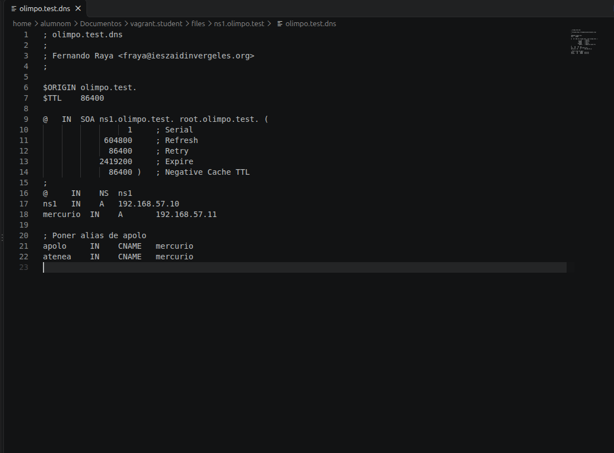

I checked it with `dig`:

```bash
vagrant ssh dns -c "dig apolo.olimpo.test"
```

```
;; ANSWER SECTION:
apolo.olimpo.test.     86400  IN  CNAME  mercurio.olimpo.test.
mercurio.olimpo.test.  86400  IN  A      192.168.57.11
```

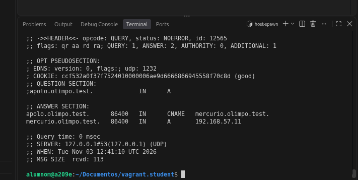

I also checked it from the `web` machine. It does not have `dig` installed, so first I installed the `bind9-dnsutils` package (the same one the `dns` machine uses):

```bash
vagrant ssh web -c "sudo apt-get install -y bind9-dnsutils"
vagrant ssh web -c "dig apolo.olimpo.test"
```

The answer is the same, and the line `SERVER: 192.168.57.10` shows that `web` is asking `ns1`:

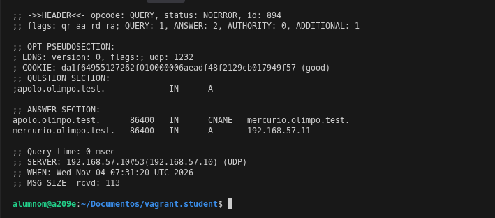

### 2.2. Site files

The document root of the site is `/var/www/apolo.olimpo.test`, with these files:

```
apolo.olimpo.test
├── apolo1.txt
├── apolo2.txt
├── apolo.html
└── messages
    └── 404.html
```

### 2.3. Custom error pages

**403 error:** when there is a 403 error, the server shows the message *You do not have permission to access apolo.olimpo.test*.

**404 error:** when there is a 404 error, the server shows the page `404.html`, which is in the `messages` folder inside the document root. It says *Resource not found on apolo.olimpo.test*.

```html
<h1>Resource not found on apolo.olimpo.test</h1>
```

I created the `messages` folders and the `404.html` pages of both sites like this:

```bash
mkdir files/apolo.olimpo.test/messages
echo "<h1>Resource not found on apolo.olimpo.test</h1>" > files/apolo.olimpo.test/messages/404.html
mkdir files/atenea.olimpo.test/messages
echo "<h1>Resource not found on atenea.olimpo.test</h1>" > files/atenea.olimpo.test/messages/404.html
```

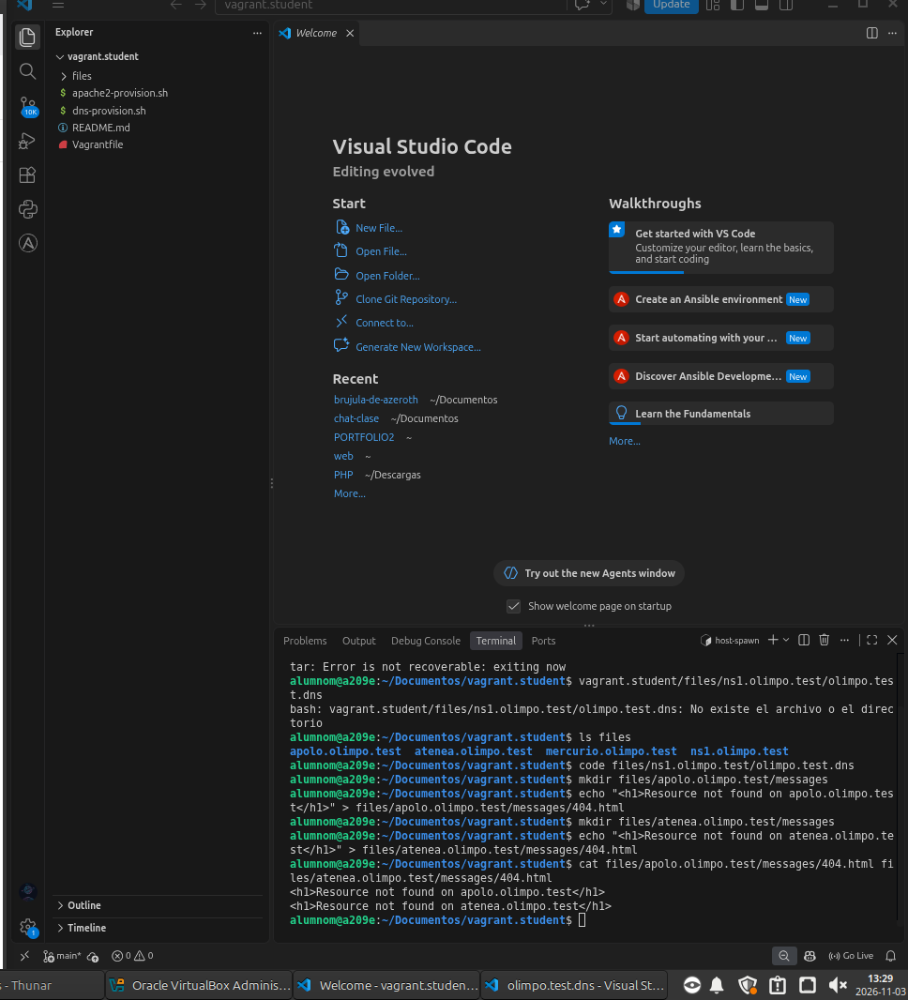

### 2.4. Log files

The site has its own error and access logs:

- `apolo.olimpo.test.error.log`
- `apolo.olimpo.test.access.log`

They are in `/var/log/apache2` on the `web` machine (you need `sudo` to read that folder):

```bash
vagrant ssh web -c "sudo ls -l /var/log/apache2"
```

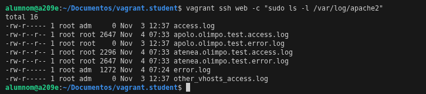

### 2.5. Directory listing

If you do not ask for a specific file (only the directory), the server shows a list of the files in the document root. This is called the *directory index*.

### 2.6. Virtual host file

All of the above goes in `apolo.olimpo.test.conf`, which is copied to `/etc/apache2/sites-available`:

```apache
<VirtualHost *:80>
    ServerName apolo.olimpo.test
    DocumentRoot /var/www/apolo.olimpo.test

    <Directory /var/www/apolo.olimpo.test>
        Options +Indexes
    </Directory>

    ErrorDocument 403 "You do not have permission to access apolo.olimpo.test"
    ErrorDocument 404 /messages/404.html

    ErrorLog ${APACHE_LOG_DIR}/apolo.olimpo.test.error.log
    CustomLog ${APACHE_LOG_DIR}/apolo.olimpo.test.access.log combined
</VirtualHost>
```

- `ServerName`: the name the site answers to.
- `DocumentRoot`: the folder with the site files.
- `Options +Indexes`: allows the file list when there is no `index.html`.
- `ErrorDocument 403` and `404`: the custom error messages.
- `ErrorLog` and `CustomLog`: the site's own logs.

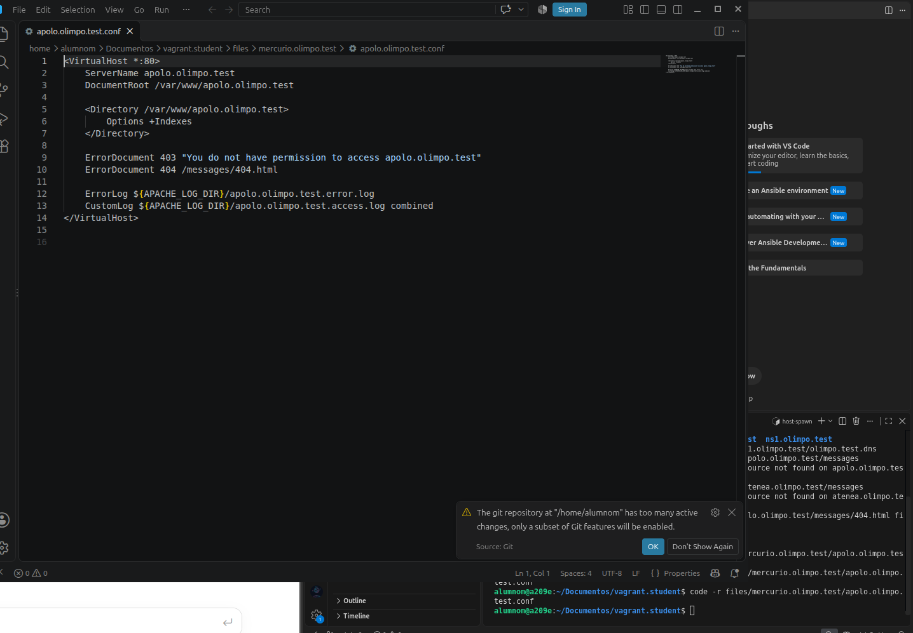

### 2.7. Checking the site

| URL | Result | Why |
|---|---|---|
| `http://apolo.olimpo.test` | List of the site files | Directory listing is allowed and there is no `index.html` |
| `http://apolo.olimpo.test/apolo.html` | Content of `apolo.html` | I asked for a specific file and I have permission |
| `http://apolo.olimpo.test/index.html` | *Resource not found on apolo.olimpo.test* | `index.html` does not exist |
| `http://apolo.olimpo.test/messages/404.html` | *Resource not found on apolo.olimpo.test* | It is the custom 404 page itself |

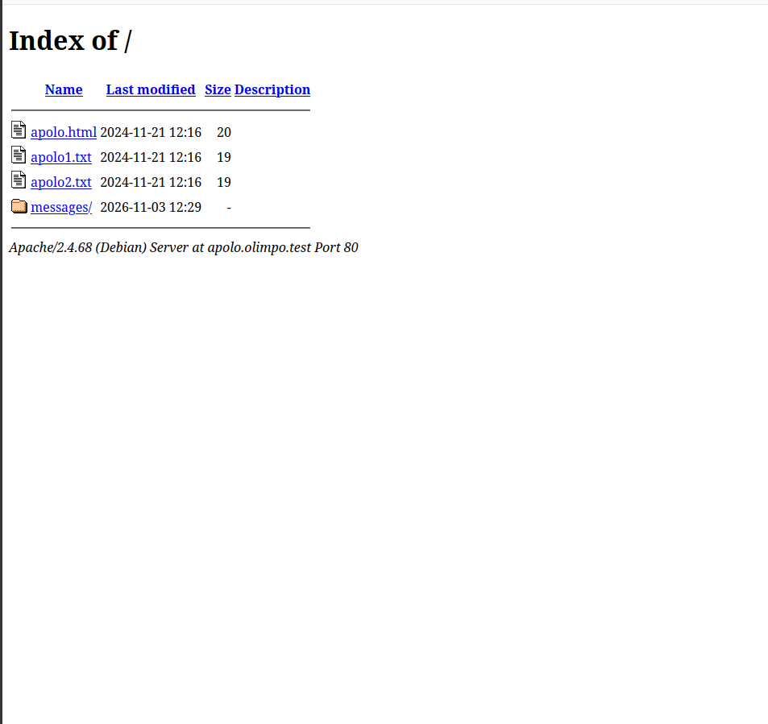

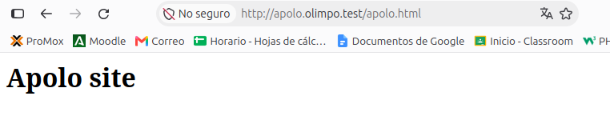

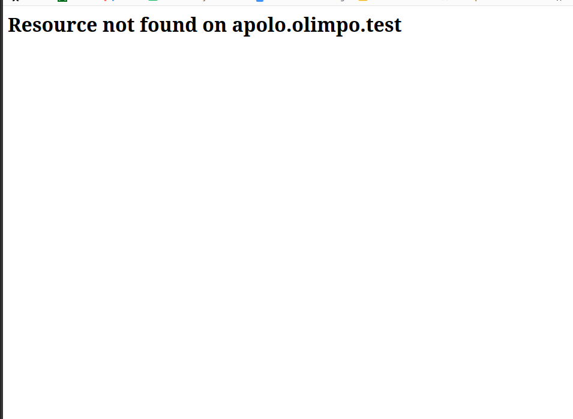

---

## 3. atenea.olimpo.test

### 3.1. DNS alias

Same as apolo, `atenea.olimpo.test` is an alias of `mercurio.olimpo.test`:

```
atenea    IN    CNAME   mercurio
```

```bash
vagrant ssh dns -c "dig atenea.olimpo.test"
vagrant ssh web -c "dig atenea.olimpo.test"
```

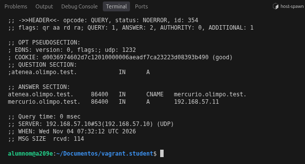

### 3.2. Site files

The document root is `/var/www/atenea.olimpo.test`:

```
atenea.olimpo.test
├── messages
│   └── 404.html
├── atenea1.txt
├── atenea2.txt
└── atenea.html
```

### 3.3. Custom error pages

**403 error:** the message is *You do not have permission to access atenea.olimpo.test*.

**404 error:** the page `messages/404.html`, with the message *Resource not found on atenea.olimpo.test*.

### 3.4. Log files

- `atenea.olimpo.test.error.log`
- `atenea.olimpo.test.access.log`

You can see them in the same log screenshot as apolo. The 403 errors of atenea are written in `atenea.olimpo.test.error.log`.

### 3.5. No directory listing

This is the big difference with apolo. If you do not ask for a specific file, atenea does **not** show the file list. It shows the custom 403 error instead.

### 3.6. Virtual host file

`atenea.olimpo.test.conf`, also in `/etc/apache2/sites-available`:

```apache
<VirtualHost *:80>
    ServerName atenea.olimpo.test
    DocumentRoot /var/www/atenea.olimpo.test

    <Directory /var/www/atenea.olimpo.test>
        Options -Indexes
    </Directory>

    ErrorDocument 403 "You do not have permission to access atenea.olimpo.test"
    ErrorDocument 404 /messages/404.html

    ErrorLog ${APACHE_LOG_DIR}/atenea.olimpo.test.error.log
    CustomLog ${APACHE_LOG_DIR}/atenea.olimpo.test.access.log combined
</VirtualHost>
```

It is the same as apolo, but with `Options -Indexes`, so the file list is not allowed.

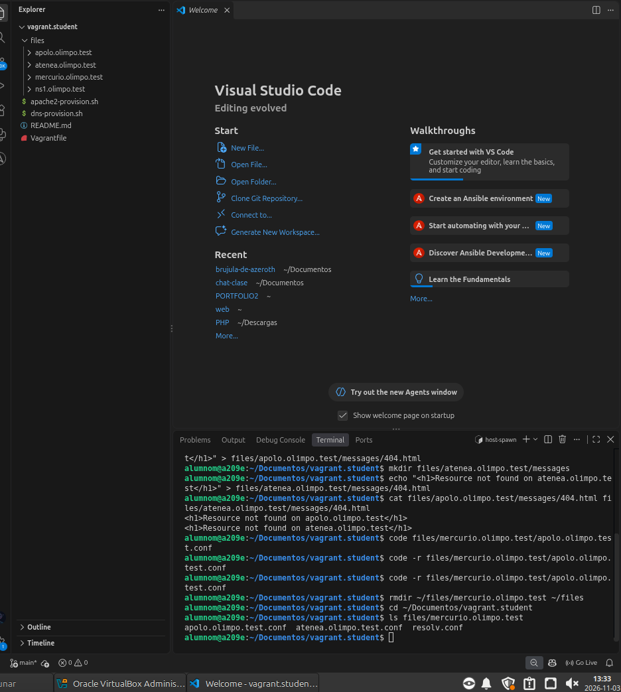

### 3.7. Checking the site

| URL | Result | Why |
|---|---|---|
| `http://atenea.olimpo.test/atenea.html` | Content of `atenea.html` | I asked for a specific file |
| `http://atenea.olimpo.test` | *You do not have permission to access atenea.olimpo.test* | Directory listing is not allowed and there is no `index.html` |
| `http://atenea.olimpo.test/index.html` | *Resource not found on atenea.olimpo.test* | `index.html` does not exist |
| `http://atenea.olimpo.test/messages` | *You do not have permission to access atenea.olimpo.test* | Directory listing is not allowed and there is no `index.html` |

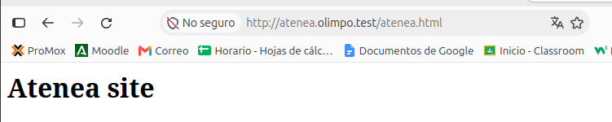

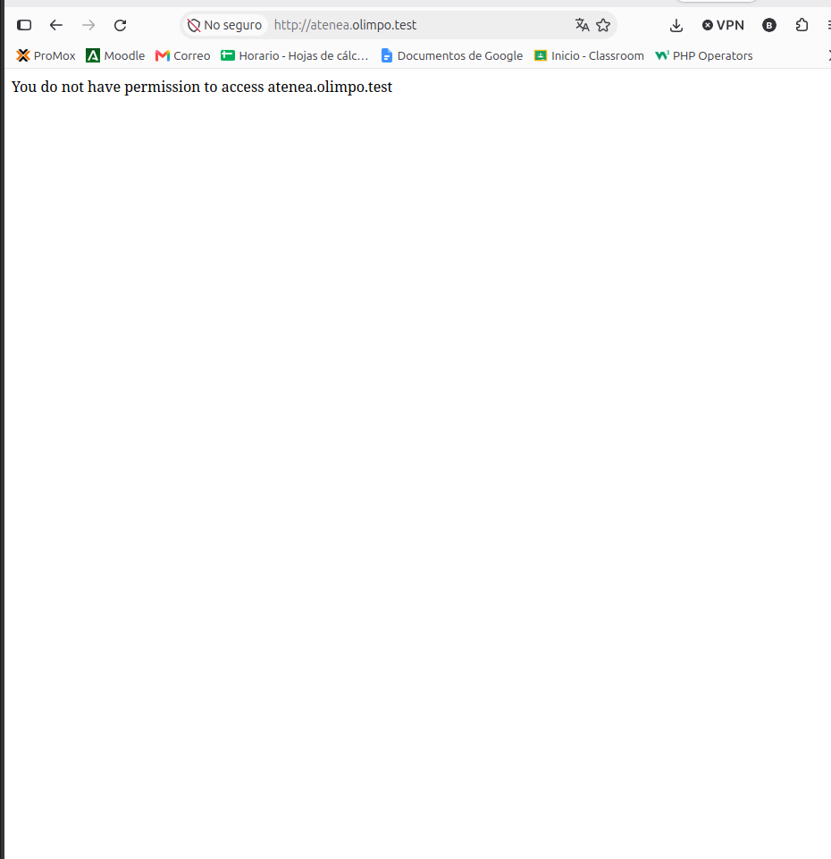

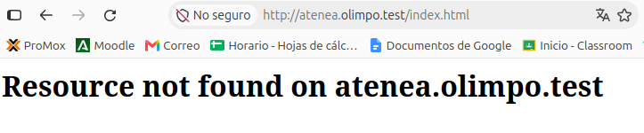


---

## 4. Enabling the sites with Vagrant

### 4.1. Provisioning script

The script `apache2-provision.sh` copies the config files, enables the virtual hosts and restarts Apache. I wrote it in the same style as `dns-provision.sh`:

```bash
#
# Copiar ficheros de configuración de apache2 que incluyen:
#
# - apache2.conf,
# - apolo.olimpo.test.conf
# - atenea.olimpo.test.conf
#

cp -v /vagrant/files/mercurio.olimpo.test/apache2.conf /etc/apache2/
cp -v /vagrant/files/mercurio.olimpo.test/apolo.olimpo.test.conf /etc/apache2/sites-available/
cp -v /vagrant/files/mercurio.olimpo.test/atenea.olimpo.test.conf /etc/apache2/sites-available/

#
# Habilitar los servidores virtuales
#

a2ensite apolo.olimpo.test.conf
a2ensite atenea.olimpo.test.conf

#
# Reiniciar el servicio
#

systemctl restart apache2
systemctl status apache2
```

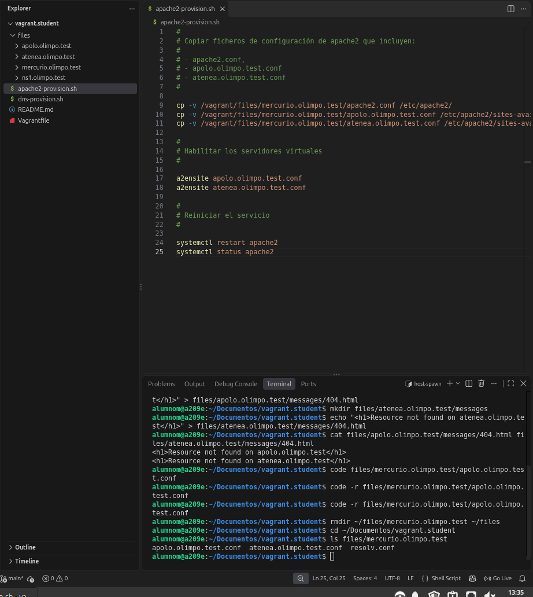

`apache2.conf` is the original Debian file, with no changes. I took it from the `web` machine after the first `vagrant up`:

```bash
vagrant ssh web -c "cp /etc/apache2/apache2.conf /vagrant/files/mercurio.olimpo.test/"
vagrant provision web
```

### 4.2. Starting everything

```bash
vagrant up
```

It creates both machines, installs BIND and Apache and runs the provisioning scripts.

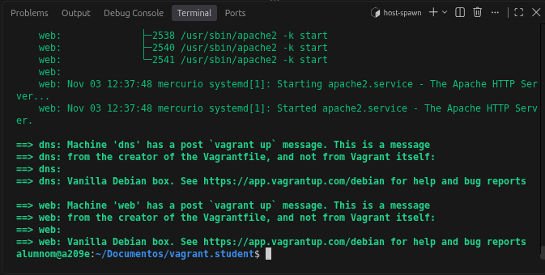

Apache starts with no errors:

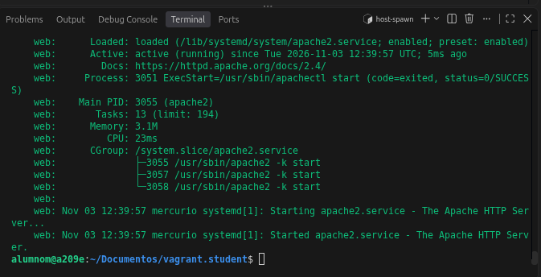

**Note:** after turning the machines off and on again (`vagrant halt` and `vagrant up`), Debian rewrites `/etc/resolv.conf` and the `web` machine stops using `ns1`. You can see it because `dig` shows `SERVER: 10.0.2.3` instead of `192.168.57.10`. To fix it, run again the step of the `Vagrantfile` that copies that file:

```bash
vagrant provision web --provision-with mercurio-resolv
```

### 4.3. Resolving the names from my computer

My own computer does not use the DNS server of the virtual machines, so to open the sites in the browser I added the names to its `hosts` file:

```
192.168.57.11   apolo.olimpo.test atenea.olimpo.test
```

- **Linux:** `/etc/hosts`
- **Windows:** `C:\Windows\System32\drivers\etc\hosts` (open the editor as administrator)

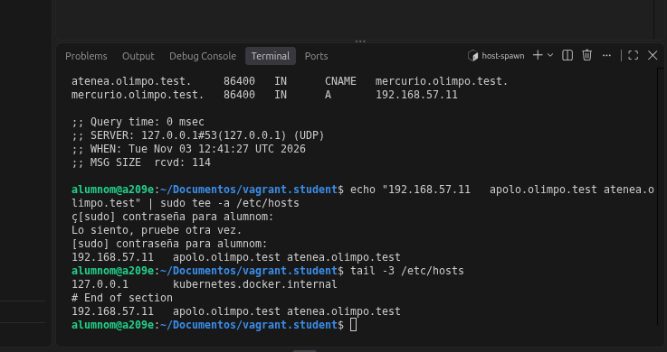

---

## 5. Testing with HURL

```bash
hurl --test --continue-on-error weblab-1-en.hurl
```

It runs 8 requests: 6 pass and 2 fail.

| Test | Result | Reason |
|---|---|---|
| `atenea.olimpo.test/soyuz.html` | Fails (404) | The file `soyuz.html` is not part of this lab |
| `atenea.olimpo.test` (403) | Fails | The test looks for the **apolo** message, but atenea must show its own message, which is what the server returns |
| The other 6 | Pass | |

These two tests do not match the lab setup, so it is normal that they fail.

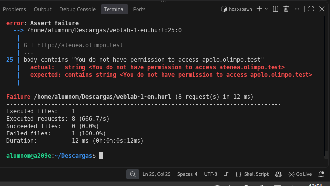

---

## 6. How I did it (Git)

I started from the original lab project and made one commit for each step.

Initial project:

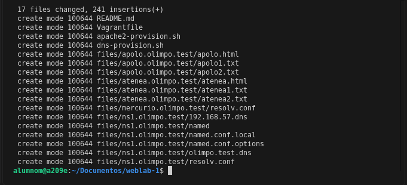

DNS aliases:

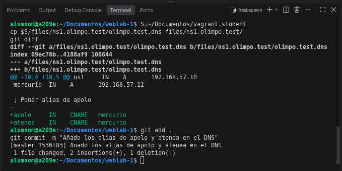

404 pages:

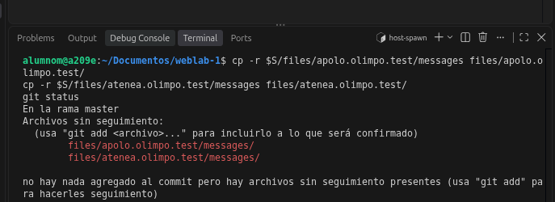

Virtual hosts:

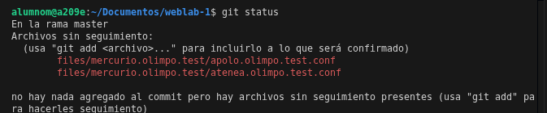

Provisioning script (in red what was in the template, in green what I added):

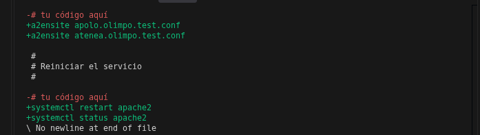

---

## 7. Key files

The `entrega/` folder has a copy of the most important files of the lab, all together so they are easy to find. The DNS zone files use the usual BIND names (`db.<zone>`):

| File in `entrega/` | What it is | Original file in the project |
|---|---|---|
| `named.conf.local` | Declares the DNS zones | `files/ns1.olimpo.test/named.conf.local` |
| `db.olimpo.test` | Forward zone, with the apolo and atenea aliases | `files/ns1.olimpo.test/olimpo.test.dns` |
| `db.192.168.57` | Reverse zone | `files/ns1.olimpo.test/192.168.57.dns` |
| `apolo.olimpo.test.conf` | apolo virtual host | `files/mercurio.olimpo.test/apolo.olimpo.test.conf` |
| `atenea.olimpo.test.conf` | atenea virtual host | `files/mercurio.olimpo.test/atenea.olimpo.test.conf` |
| `Vagrantfile` | Creates the two machines | `Vagrantfile` |
